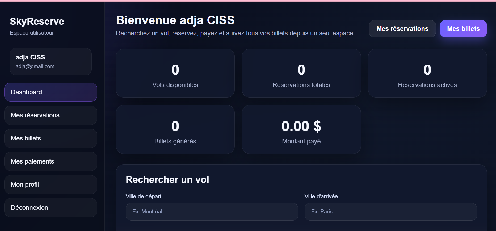

# ✈️ SkyReserve

Application web full-stack de **réservation de billets d'avion**, développée avec **Java, Spring Boot et MySQL**.

Un voyageur peut rechercher un vol, réserver, payer et retrouver ses billets dans son espace personnel. Un administrateur gère l'ensemble des données : vols, avions, aéroports, compagnies aériennes, utilisateurs, réservations, billets et paiements.



---

## Fonctionnalités

### Espace voyageur
- Inscription et connexion
- Tableau de bord avec statistiques personnelles (réservations, billets, montant payé)
- Recherche de vols par ville de départ et d'arrivée
- Réservation et paiement
- Consultation de ses réservations, billets et paiements
- Gestion du profil

### Espace administrateur
- Connexion administrateur
- Gestion complète (ajout, modification, suppression) des :
  - vols, avions, aéroports et compagnies aériennes
  - utilisateurs et administrateurs
  - réservations, billets et paiements

---

## Technologies

| Couche | Technologies |
|---|---|
| Back-end | Java 17, Spring Boot, Spring Data JPA (Hibernate), Bean Validation, Lombok |
| Base de données | MySQL |
| Front-end | HTML, CSS, JavaScript (Fetch API) |
| Outils | Maven, Git / GitHub, Postman |

## Architecture

Le back-end suit une architecture en couches :

```
src/main/java/com/example/reservation_billets1/
├── Modele/        → entités JPA (Vol, Reservation, Billet, Paiement, ...)
├── Repository/    → accès aux données (Spring Data JPA)
├── Services/      → logique métier
├── Controlleur/   → API REST
└── Config/        → configuration (CORS)

src/main/resources/static/   → pages HTML, CSS et JavaScript du front-end
```

Le front-end communique avec l'API REST exposée sous `/api/reservationBillets`.

---

## Lancer le projet

### Prérequis
- Java 17
- MySQL

### 1. Créer la base de données

```sql
CREATE DATABASE r_Billets;
```

Les tables sont créées automatiquement au démarrage par Hibernate.

### 2. Configurer l'accès à MySQL

Les identifiants sont lus depuis des variables d'environnement (par défaut : utilisateur `root`, mot de passe vide) :

```bash
export DB_USERNAME=root
export DB_PASSWORD=ton_mot_de_passe
```

### 3. Démarrer l'application

```bash
./mvnw spring-boot:run
```

Sous Windows : `mvnw.cmd spring-boot:run`

### 4. Ouvrir l'application

- Espace voyageur : http://localhost:8080/Reservation_Billets/LoginUtilisateur.html
- Espace administrateur : http://localhost:8080/Reservation_Billets/login.html

### 5. Créer un premier administrateur

Avec Postman, envoyer une requête `POST` à
`http://localhost:8080/Reservation_Billets/api/reservationBillets/ajouterAdmin` :

```json
{
  "nom": "Admin",
  "prenom": "Principal",
  "email": "admin@email.com",
  "motDePasse": "1234"
}
```

Ordre conseillé pour créer les données de test : compagnies → avions → aéroports → vols → utilisateurs → réservations → billets → paiements.

---

## Améliorations prévues

- Chiffrement des mots de passe avec BCrypt
- Authentification côté serveur avec Spring Security
- Tests unitaires et d'intégration

---

## Autrice

**Adja Fatou CISS** — étudiante en Techniques de l'informatique (programmation), Collège LaSalle, Montréal

- Portfolio : _à ajouter_
- GitHub : [@Adjafatouciss](https://github.com/Adjafatouciss)
