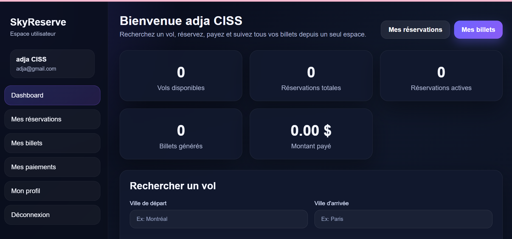

# ✈️ SkyReserve

Application web full-stack de **réservation de billets d'avion**, développée avec **Java, Spring Boot et MySQL**.

Un voyageur peut rechercher un vol, réserver, payer et retrouver ses billets dans son espace personnel. Un administrateur gère l'ensemble des données : vols, avions, aéroports, compagnies aériennes, utilisateurs, réservations, billets et paiements.

**[Tester la démo en ligne](https://skyreserve-kb9y.onrender.com/Reservation_Billets/LoginUtilisateur.html)** · compte voyageur : `demo@skyreserve.ca` / `demo1234` · [espace administrateur](https://skyreserve-kb9y.onrender.com/Reservation_Billets/login.html) : `admin@skyreserve.ca` / `demo1234`

> Hébergement gratuit : le premier chargement peut prendre environ une minute.



---

## Fonctionnalités

### Espace voyageur
- Inscription et connexion
- Tableau de bord avec statistiques personnelles (réservations, billets, montant payé)
- Recherche de vols par ville de départ et d'arrivée
- Réservation et paiement
- Consultation de ses réservations, billets et paiements
- Gestion du profil

### Espace administrateur
- Connexion administrateur
- Gestion complète (ajout, modification, suppression) des :
  - vols, avions, aéroports et compagnies aériennes
  - utilisateurs et administrateurs
  - réservations, billets et paiements

---

## Technologies

| Couche | Technologies |
|---|---|
| Back-end | Java 17, Spring Boot, Spring Security, Spring Data JPA (Hibernate), Bean Validation, Lombok |
| Base de données | MySQL (local), PostgreSQL (en ligne) |
| Front-end | HTML, CSS, JavaScript (Fetch API) |
| Outils | Maven, Git / GitHub, Postman |

## Architecture

Le back-end suit une architecture en couches :

```
src/main/java/com/example/reservation_billets1/
├── Modele/        → entités JPA (Vol, Reservation, Billet, Paiement, ...)
├── Repository/    → accès aux données (Spring Data JPA)
├── Services/      → logique métier
├── Controlleur/   → API REST
└── Config/        → configuration (CORS)

src/main/resources/static/   → pages HTML, CSS et JavaScript du front-end
```

Le front-end communique avec l'API REST exposée sous `/api/reservationBillets`.

---

## Sécurité (Spring Security)

- **Mots de passe chiffrés avec BCrypt** ; les anciens mots de passe en clair sont convertis automatiquement au démarrage.
- **Connexion vérifiée par le serveur** : une session est ouverte après `/loginUtilisateur` ou `/loginAdmin`.
- **Accès par rôle** :

| Accès | Routes |
|---|---|
| Public | connexion, inscription, liste et détail des vols |
| Utilisateur connecté | ses réservations, billets, paiements et son profil uniquement |
| Administrateur | gestion des vols, avions, aéroports, compagnies, utilisateurs, admins, et toutes les données |

- **Protection CSRF** : jeton dans le cookie `XSRF-TOKEN`, renvoyé par `config.js` dans l'en-tête `X-XSRF-TOKEN`.
- Les mots de passe ne sont jamais renvoyés par l'API.

---

## Lancer le projet

### Prérequis
- Java 17
- MySQL

### 1. Créer la base de données

```sql
CREATE DATABASE r_Billets;
```

Les tables sont créées automatiquement au démarrage par Hibernate.

### 2. Configurer l'accès à MySQL

Les identifiants sont lus depuis des variables d'environnement (par défaut : utilisateur `root`, mot de passe vide) :

```bash
export DB_USERNAME=root
export DB_PASSWORD=ton_mot_de_passe
```

### 3. Démarrer l'application

```bash
./mvnw spring-boot:run
```

Sous Windows : `mvnw.cmd spring-boot:run`

### 4. Ouvrir l'application

- Espace voyageur : http://localhost:8080/Reservation_Billets/LoginUtilisateur.html
- Espace administrateur : http://localhost:8080/Reservation_Billets/login.html

### 5. Données de démonstration (optionnel)

Avec la variable `DEMO_DATA=true`, l'application crée au démarrage des compagnies, des avions, des aéroports, des vols, ainsi que deux comptes de test :

| Espace | Courriel | Mot de passe |
|---|---|---|
| Voyageur | demo@skyreserve.ca | demo1234 |
| Administrateur | admin@skyreserve.ca | demo1234 |

### 6. Créer un premier administrateur (sans données de démonstration)

Avec Postman, envoyer une requête `POST` à
`http://localhost:8080/Reservation_Billets/api/reservationBillets/ajouterAdmin` :

```json
{
  "nom": "Admin",
  "prenom": "Principal",
  "email": "admin@email.com",
  "motDePasse": "1234"
}
```

Ordre conseillé pour créer les données de test : compagnies → avions → aéroports → vols → utilisateurs → réservations → billets → paiements.

---

## Déploiement en ligne

Le projet contient un `Dockerfile` pour être déployé sur [Render](https://render.com) avec une base PostgreSQL gratuite hébergée sur [Aiven](https://aiven.io). Grâce à JPA/Hibernate, le même code fonctionne avec MySQL en local et PostgreSQL en ligne.

Variables d'environnement à définir sur Render :

| Variable | Exemple |
|---|---|
| `DB_URL` | `jdbc:postgresql://<hôte>:<port>/defaultdb?sslmode=require` |
| `DB_USERNAME` | `avnadmin` |
| `DB_PASSWORD` | le mot de passe fourni par Aiven |
| `DEMO_DATA` | `true` |
| `SHOW_SQL` | `false` |

---

## Améliorations prévues

- Tests unitaires et d'intégration

---

## Autrice

**Adja Fatou CISS** — étudiante en Techniques de l'informatique (programmation), Collège LaSalle, Montréal

- Portfolio : [adjafatouciss.github.io](https://adjafatouciss.github.io)
- GitHub : [@Adjafatouciss](https://github.com/Adjafatouciss)
